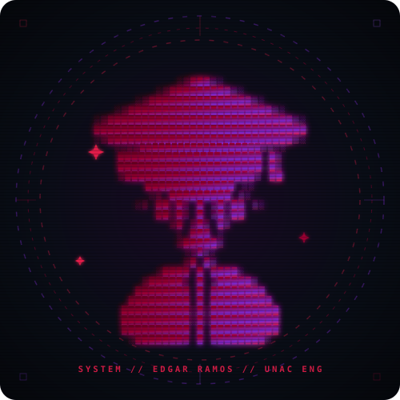

  <!-- ==================== HEADER (LOCAL SVG) ==================== -->
  

 

<!-- ==================== LAYOUT HORIZONTAL DE DOS COLUMNAS (WIDE RETRO HUD) ==================== -->
<table width="100%" border="0">
  <tr>
    <!-- COLUMNA IZQUIERDA: AVATAR MATRIX ANIMADO -->
    <td width="38%" align="center" valign="middle" style="background:#090D16; border:1px solid #7928CA; border-radius:12px; padding:20px;">
      
        
      
       
      

        <b>EDGAR RAMOS TRUJILLO</b> 
        Sistemas UNAC • AI & DevOps
      

    </td>

    <!-- COLUMNA DERECHA: CONSOLA Y TELEMETRÍA EN TIEMPO REAL -->
    <td width="62%" valign="top" style="background:#090D16; border:1px solid #990033; border-radius:12px; padding:20px;">
      
      <!-- SUBTÍTULO ANIMADO TYPING -->
      

      <!-- PILLS DE ESTADO Y ENFOQUE -->
      

        
        
        
      

      <!-- TERMINAL SYS-INFO -->
      <pre style="background:#05070B; border:1px solid #30363D; border-radius:6px; padding:12px; font-family:'Fira Code', monospace; font-size:11.5px; color:#F0F6FC; margin:10px 0;">
❯ whoami
  Edgar Ramos Trujillo | AI Engineering & Cloud DevOps

❯ core_specialties
  ├── <b>Autonomous Systems</b> : FastMCP, Model Context Protocol, LLM Orchestration
  ├── <b>Backend & Pipelines</b> : Python (FastAPI/Scrapy), TypeScript, Supabase (RLS/Auth)
  └── <b>Infrastructure Ops</b> : Docker Containers, WebRTC Streaming (LiveKit), GitHub Actions</pre>

      <!-- LET'S CONNECT BUTTONS WIDE -->
      

        
        
        
        
        
      

    </td>
  </tr>
</table>

 

<!-- ==================== TECH STACK APILADO WIDE ==================== -->
### 🛠️ Core Tech Stack & Tooling

<table width="100%">
  <thead>
    <tr style="border-bottom: 2px solid #8A2BE2;">
      <th width="28%" align="left" style="background:#161B22; color:#A855F7; padding:10px;">Domain</th>
      <th width="72%" align="left" style="background:#161B22; color:#00FF66; padding:10px;">Production Tooling & Frameworks</th>
    </tr>
  </thead>
  <tbody>
    <tr>
      <td><b>🧠 AI & Agent Systems</b></td>
      <td>
        
        
        
        
        
        
      </td>
    </tr>
    <tr>
      <td><b>⚙️ Backend & Data Engine</b></td>
      <td>
        
        
        
        
        
        
        
      </td>
    </tr>
    <tr>
      <td><b>🚀 DevOps & Cloud Ops</b></td>
      <td>
        
        
        
        
        
      </td>
    </tr>
    <tr>
      <td><b>🎨 Modern Interfaces</b></td>
      <td>
        
        
        
        
        
      </td>
    </tr>
  </tbody>
</table>

 

  

 

<!-- ==================== TELEMETRÍA Y CONTRIBUCIONES (SNAKE SOBRE HISTORIAL REAL) ==================== -->
### 📊 Telemetry & Live Contributions

<table width="100%" border="0">
  <tr>
    <td width="33%" align="center">
      
    </td>
    <td width="33%" align="center">
      
    </td>
    <td width="34%" align="center">
      
    </td>
  </tr>
</table>

 

<!-- ANIMATED SNAKE GRID CONTROLLER (DIRECTO DESDE RAMA OUTPUT CON TUS COMMITS REALES) -->

  

    ● <b>LIVE CONTRIBUTION SNAKE</b> // Traversing active commit history
  

  

 

<!-- ==================== FEATURED SYSTEMS EN LA PARTE FINAL PARA MÁXIMO IMPACTO ==================== -->
### 🚀 Production Systems & Featured Projects

<table width="100%">
  <thead>
    <tr style="border-bottom: 2px solid #990033;">
      <th width="32%" align="left" style="background:#161B22; color:#A855F7; padding:10px;">Project Architecture</th>
      <th width="48%" align="left" style="background:#161B22; color:#F0F6FC; padding:10px;">Description & Key Highlights</th>
      <th width="20%" align="center" style="background:#161B22; color:#00FF66; padding:10px;">Stack / Pipeline</th>
    </tr>
  </thead>
  <tbody>
    <tr>
      <td>
        <b><a href="https://github.com/Tiburonchin/UNAC_POS-Carpetas">⚡ epg-admissions-engine</a></b>
      </td>
      <td>
        Motor integral para admisión y control de expedientes de la Escuela de Posgrado UNAC. Automatización de subida documental, validación en tiempo real y notificaciones omnicanal vía WhatsApp y correo transaccional.
      </td>
      <td align="center">
        
        
        
        
      </td>
    </tr>
    <tr>
      <td>
        <b><a href="https://github.com/Tiburonchin/Chatterbox">🤖 chatterbox-agent-orchestrator</a></b>
      </td>
      <td>
        Orquestación de agentes autónomos y herramientas contextuales con Python y LLMs locales/cloud. Conexión de servidores MCP para delegación de tareas automatizadas de alta fidelidad.
      </td>
      <td align="center">
        
        
        
        
      </td>
    </tr>
    <tr>
      <td>
        <b><a href="https://github.com/Tiburonchin/AUTOSCRAPING_PE">🕷️ pe-distributed-scraper</a></b>
      </td>
      <td>
        Pipeline distribuido de recolección y minería de datos web resiliente a bloqueos de IP, estructuración tabular y ETL automatizado hacia almacenes relacionales.
      </td>
      <td align="center">
        
        
        
        
      </td>
    </tr>
    <tr>
      <td>
        <b><a href="https://github.com/Tiburonchin/SLA_prog">⏱️ sla-monitoring-core</a></b>
      </td>
      <td>
        Módulo modular de cálculo y aseguramiento de Service Level Agreements (SLA) basado en TypeScript, implementando Clean Architecture y pruebas unitarias de rigor.
      </td>
      <td align="center">
        
        
        
        
      </td>
    </tr>
    <tr>
      <td>
        <b><a href="https://github.com/Tiburonchin/SCRIPT_CORREO">📬 bulk-mail-dispatcher-py</a></b>
      </td>
      <td>
        Motor batch para despacho de notificaciones masivas personalizadas a partir de esquemas Excel/CSV, sanitización de datos y manejo de colas de envío.
      </td>
      <td align="center">
        
        
        
        
      </td>
    </tr>
  </tbody>
</table>

 

<!-- ==================== FOOTER DINÁMICO CAPSULE (LOCAL SVG) ==================== -->

  
  
  

    Designed with precision & engineered for real-world impact • © Edgar Ramos Trujillo (Tiburonchin)
  

