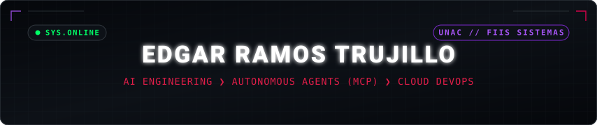
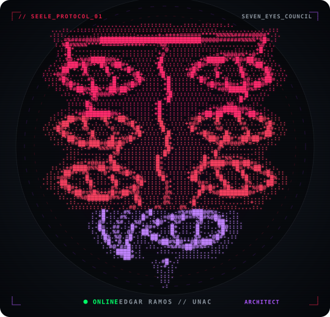
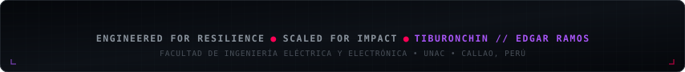

<!-- ==================== BENTO GRID HERO: SEELE ASCII + TERMINAL ==================== -->
<table width="100%" border="0" cellpadding="0" cellspacing="0">
<tr>
<td width="33%" align="center" valign="top">

</td>
<td width="2%"></td>
<td width="65%" valign="top">

</td>
</tr>
</table>

<!-- ==================== CORE TECH STACK ==================== -->

<h3>// CORE TECH STACK &amp; TOOLING //</h3>

<table width="100%" border="0" cellpadding="0" cellspacing="0">
<tr>
<td width="49%" valign="top">
<b>AI &amp; AGENT SYSTEMS</b> 
• <code>Languages &amp; SDKs</code> : Python 3.11+, LangChain, PyTorch, Ollama 
• <code>Protocols &amp; APIs</code> : FastMCP / Model Context Protocol, HuggingFace
</td>
<td width="2%"></td>
<td width="49%" valign="top">
<b>BACKEND &amp; CLOUD OPS</b> 
• <code>Core Runtimes</code> : TypeScript, Node.js, FastAPI, PHP 
• <code>Containers &amp; DB</code> : Docker, PostgreSQL, Supabase, MySQL, LiveKit WebRTC
</td>
</tr>
</table>

<!-- ==================== TELEMETRÍA Y CONTRIBUCIONES ==================== -->

<h3>// TELEMETRY &amp; LIVE STATS //</h3>

<!-- ==================== PRODUCTION SYSTEMS & FEATURED REPOSITORIES ==================== -->

<h3>// PRODUCTION SYSTEMS &amp; FEATURED PROJECTS //</h3>

<table width="100%" border="0" cellpadding="0" cellspacing="0">
<tr>
<td width="49%" valign="top">
<h4><a href="https://github.com/Tiburonchin/ELIS_5.vs2.2">ELIS 5.0 — Cloud-Native HSE &amp; Forensics Platform</a></h4>
Plataforma empresarial para auditoría forense e inspección HSE en campo. Deduplicación criptográfica de imágenes (SHA-256 en WebCrypto), OCR en navegador con Tesseract.js Web Workers y sincronización atómica Postgres RPC. 
• <b>Stack:</b> <code>React 19</code> <code>TypeScript</code> <code>Supabase Cloud</code> <code>Tesseract OCR</code> <code>Tailwind v4</code>

<h4><a href="https://github.com/Tiburonchin/posgrado_carpetas">POSGRADO-UNAC-2026B — Sistema de Gestión de Carpetas</a></h4>
Plataforma digital para la Escuela de Posgrado UNAC. Automatización del flujo de expedientes y carpetas de postulantes, validación documental y seguimiento coordinado por unidades académicas. 
• <b>Stack:</b> <code>JavaScript</code> <code>PHP</code> <code>MySQL</code> <code>REST API</code> <code>TailwindCSS</code>
</td>
<td width="2%"></td>
<td width="49%" valign="top">
<h4><a href="https://github.com/Tiburonchin/AUTOSCRAPING_PE">pe-distributed-scraper</a></h4>
Pipeline distribuido de recolección y minería de datos web con arquitectura tolerante a fallos, esquemas dinámicos y ETL hacia almacenes relacionales. 
• <b>Stack:</b> <code>Python</code> <code>Scrapy</code> <code>Data Mining</code> <code>ETL Pipeline</code>

<h4><a href="https://github.com/Tiburonchin/SLA_prog">sla-monitoring-core</a></h4>
Módulo de cálculo y aseguramiento de Service Level Agreements (SLA) basado en Clean Architecture, alta cohesión y cobertura de pruebas unitarias. 
• <b>Stack:</b> <code>TypeScript</code> <code>Clean Architecture</code> <code>Jest</code> <code>Node.js</code>
</td>
</tr>
</table>

<!-- ==================== WEBSITES & LIVE PLATFORMS SHOWCASE ==================== -->

<h3>// LIVE PLATFORMS &amp; WEB DEPLOYMENTS //</h3>

<table width="100%" border="0" cellpadding="0" cellspacing="0">
<tr>
<td width="49%" valign="top">
<h4><a href="https://posgradounac.edu.pe/">Escuela de Posgrado UNAC — Portal Oficial</a></h4>
Portal institucional de alta demanda para la gestión de programas de maestría y doctorado, admisiones y servicios académicos de la Universidad Nacional del Callao. 
• <b>URL En Vivo:</b> <a href="https://posgradounac.edu.pe/"><code>posgradounac.edu.pe</code></a> 
• <b>Enfoque:</b> UI/UX institucional, optimización SEO y pasarela informativa.
</td>
<td width="2%"></td>
<td width="49%" valign="top">
<h4><a href="https://doctorcabello.pe/">Doctor Cabello — Plataforma Web Comercial</a></h4>
Sitio web corporativo y de catálogo comercial con diseño premium responsivo, micro-animaciones, optimización de velocidad de carga y captura de leads. 
• <b>URL En Vivo:</b> <a href="https://doctorcabello.pe/"><code>doctorcabello.pe</code></a> 
• <b>Enfoque:</b> Branding digital, conversión comercial y Tailwind/WordPress architecture.
</td>
</tr>
</table>

<!-- ==================== SPECIAL DEDICATION (FOOTNOTE) ==================== -->

✦ <i>Desarrollo interactivo dedicado con cariño a mi pareja: <a href="https://github.com/Tiburonchin/ELENA">ELENA (código abierto como referencia de experiencia SPA lúdica)</a></i> ✦

<!-- ==================== CONNECT HUB ==================== -->

<h3>// CONNECT &amp; COMMUNICATION CHANNELS //</h3>

<!-- ==================== FOOTER ==================== -->

